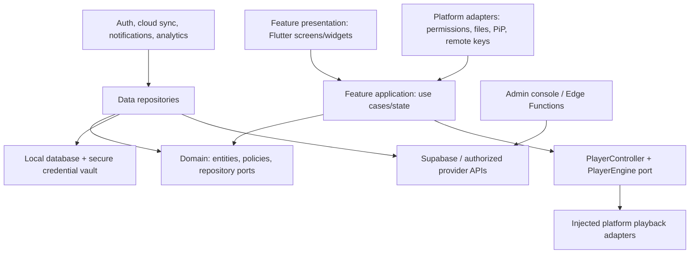

# System Architecture

**Status:** Design blueprint; not implemented.  
**Inputs:** Prompt 01 audit and attached HTML prototype review (static only).  
**Figma:** No Figma integration is available in this workspace; no Figma file was created.

## Architecture Goals

- Deliver an all-in-one media client for user-owned, licensed, or explicitly authorized content.
- Keep browsing and playback metadata local-first, with explicit opt-in cloud sync and deterministic conflict handling.
- Keep presentation independent from storage vendors, Supabase SDK details, and playback packages.
- Make platform capability explicit. A package dependency, folder, feature flag, or mock is not proof of platform support.
- Keep credentials, authorization, privacy, and content-provider constraints in the data flow from the start.

## Current Baseline

Prompt 01 found an early Flutter scaffold: a loading-only root screen; route/config/model declarations; partial Supabase Auth and console analytics source; no feature screens, router, repositories, generated model parts, test source, native platform project, Supabase schema, or playback engine. Flutter/Dart commands could not run in the audit environment. The attached HTML prototype has browser-side demos for M3U parsing/filtering, browser HLS/MPEG-TS, local files, a YouTube iframe, subtitles, favorites/recent in localStorage and browser PiP. It was not executed or behavior-tested and is not the Flutter product baseline.

The prototype also contains an embedded external playlist with tokenized stream URLs and an optional public CORS proxy path that forwards a user's stream URL to a third party. Do not copy its channel data, URLs, tokens, proxy flow, or vendor-branded UI labels into the app. Treat exposed provider tokens as compromised and request provider-side invalidation where applicable. Keep only the general information architecture (player plus directory, category/search controls, responsive modes) as a visual reference.

## Layered Architecture

Dependency direction is inward: presentation -> application -> domain. Data and platform adapters implement domain/application ports. Domain code must not import Flutter widgets, Supabase, Hive/Isar, or `media_kit`. UI must never instantiate a concrete playback package.

## Ownership Boundaries

| Boundary | Owns | Must not own |
|---|---|---|
| `app/` | App composition, routing, themes, feature/platform configuration | Business rules, provider credentials |
| `features/*/presentation` | Screens, accessible controls, view state rendering | SQL, network calls, player package objects |
| `features/*/application` | Use cases, orchestration, state transitions | Widget layout, direct persistence SDK calls |
| `domain/` | Entities, value objects, policies, repository/player ports | Flutter, Supabase, platform plugin imports |
| `data/` | Repository implementations, DTO mapping, migrations/adapters | Screen-specific state or unredacted analytics |
| `services/` | Auth, cloud sync, analytics, notifications, diagnostics | Feature-specific UI decisions |
| `playback/` | Stable player session/controller contract and adapter selection | Playlist ownership, UI navigation |
| `platform_adapters/` | Permissions, file pickers, PiP, device/remote integration | Cross-platform product policy |
| Supabase | User-scoped records, RLS, trusted Edge Functions | Provider passwords or privileged keys in client records |

## Local-First Data and Sync

1. Validate a user action in an application use case.
2. Commit local data and an outbox operation transactionally. A local write should remain usable when offline.
3. Sync worker sends only allow-listed, sanitized metadata with an idempotency key; credentials and playable URLs are excluded by default.
4. Server authenticates the user, applies RLS/validation, and returns a canonical revision and cursor.
5. Repository marks the outbox item complete and merges server-owned fields.
6. Retry transient errors with bounded exponential backoff; surface conflicts instead of silently overwriting.

Conflict defaults: favorites are set-membership/idempotent; settings are last-write-wins per key with server revision; watch progress uses latest `updated_at` and monotonic clamped position; playlist metadata uses explicit field-level merge. Deletion uses tombstones until all enrolled devices have acknowledged or a retention window expires. Device revocation stops future sync and token refresh.

Never sync a raw M3U URL if it may contain a token, username, or password. Cloud playlist sync initially carries metadata only; re-authentication/re-entry on another device is required unless a separately approved credential-vault design exists. Keep raw stream locators in device-local protected storage and redact them from logs, crash reports, analytics, bug reports, and URLs.

## Playback Boundary

`PlayerController` is the app-facing session owner; `PlayerEngine` is a narrow async port for open/play/pause/seek/stop/dispose, position/buffer/duration, tracks, errors, and capabilities. The application layer supplies authorized media descriptors; adapters translate them into engine-specific sources. Controllers own lifecycle and state mapping, not platform widgets.

Candidate adapters are `media_kit` for validated Android/desktop targets, an optional Android Media3 adapter where native capabilities justify it, and separately designed Tizen/webOS adapters. Do not load multiple engines for one session. Capability negotiation must fail closed with a user-readable unsupported message. DRM, provider authentication, recording, downloads, PiP, casting, and multi-view are enabled only when the content license, platform, provider and adapter all permit them.

## Backend and Authorization

Supabase Auth issues user sessions. Postgres tables are owner-scoped with RLS enabled and tested. Client keys are public identifiers, not authorization controls. Service-role credentials and admin operations stay in Edge Functions/secure server infrastructure. Admin dashboard data changes require server-side role checks and audit events; no client-writable `is_admin` field.

API shapes are specified in [../api/API_CONTRACT.md](../api/API_CONTRACT.md); schema and row policies are in [../database/SCHEMA.md](../database/SCHEMA.md). These are design contracts, not deployed migrations or a live API.

## Cross-Cutting Requirements

- **Errors:** typed domain failures; distinguish offline, auth expired, forbidden, invalid content, unsupported codec, provider rejection, and unknown engine failure. Never expose raw provider response bodies.
- **Observability:** structured event codes, redaction by construction, consent, retention, and user opt-out. No URL/credential/content-title analytics by default.
- **Security:** validate remote URLs, allow only supported schemes, defend against local/private-network SSRF in any server fetcher, and do not route user streams through public CORS proxies.
- **Accessibility:** semantic labels, scalable text, contrast, keyboard/D-pad traversal, visible focus, reduced motion, and Bengali script coverage.
- **Licensing:** supply only empty/demo fixtures with documented rights; no bundled third-party IPTV playlist or scraped catalog.

## Architecture Review and Prompt 03 Gate

**Review conclusion:** The current code is not ready for feature implementation. First stabilize source/build inputs and approve data/credential boundaries. Keep Tizen and webOS as separate feasibility work, not promised Flutter targets.

Prompt 03 may begin implementation only when all are true:

1. A Flutter SDK/channel and initial target are recorded; a clean dependency resolution and lockfile exist.
2. Missing local imports/generated outputs are resolved and `flutter analyze`, unit tests, and an Android debug build have recorded results.
3. Product owner approves the lawful content-source scope and the initial MVP slice.
4. Local database, secret handling, sync conflict rules, schema and RLS tests are reviewed; HIGH/CRITICAL security changes have explicit approval.
5. Playback contract and supported adapter proof-of-concept are accepted on a real/emulated target.
6. UI tokens/components and screen flows are approved from the Figma-ready specs; no unsupported smart-TV behavior is advertised.
7. CI enforces formatting, analysis, tests, secret checks and target builds.
